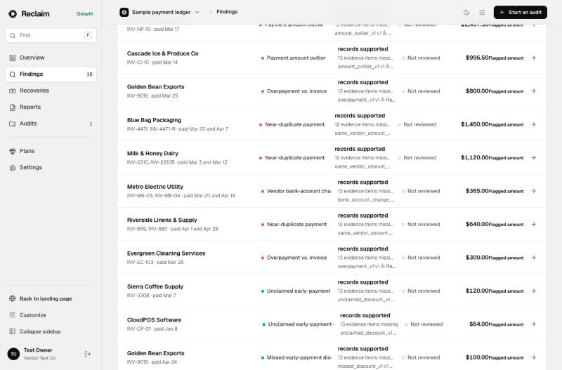
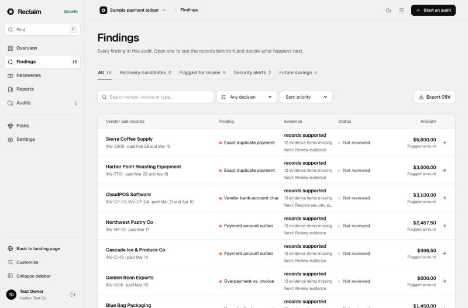
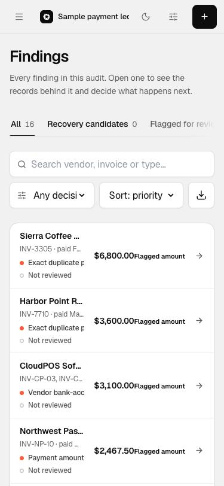
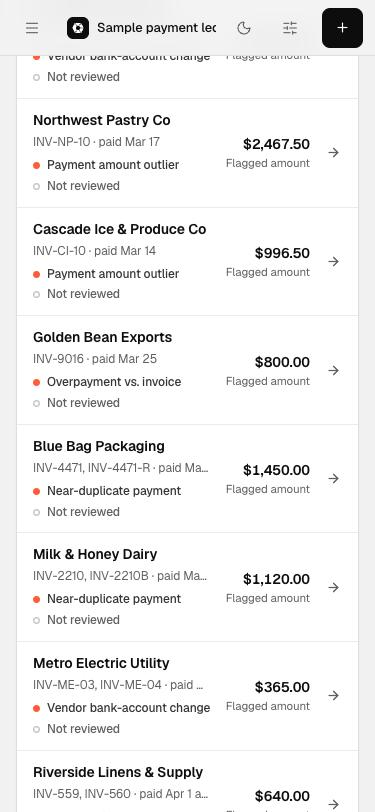
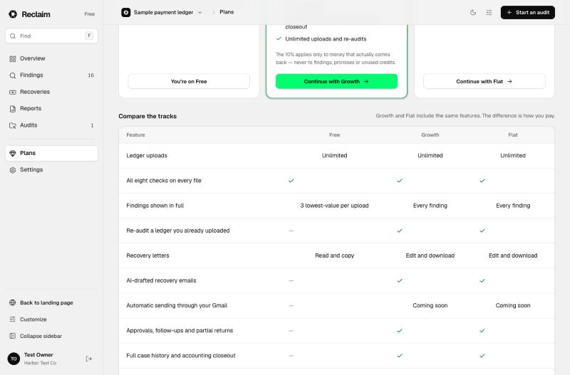
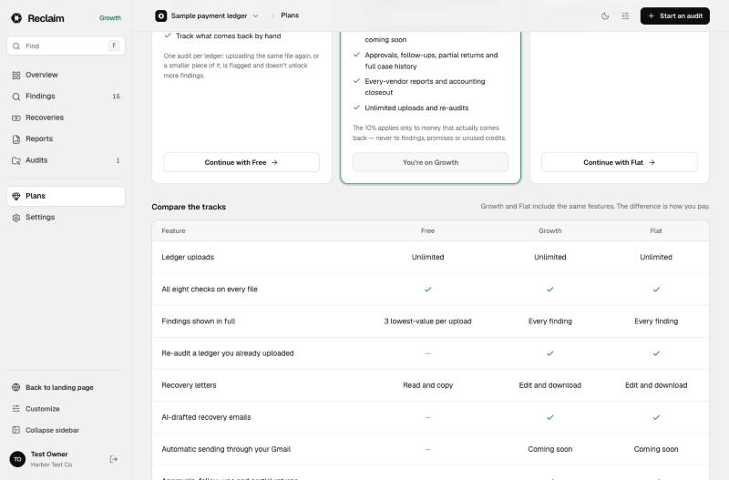

# Dashboard review: first-time owner pass (REC-8)

Reviewed 2026-10-16 on the sample ledger (80 payments, 12 vendors), signed in as a throwaway local account, on Free and Growth, light and dark, at 1366×900 and 375×812. Ran against an isolated API and database, not the owner's account. Page references are `?mode=` values under `/audit`. A finding about the sample ledger also applies to any CSV export that has no currency column, which covers most QuickBooks and Xero exports.

Screenshots are in [`dashboard-review/`](dashboard-review/). Contrast is not a problem. All muted text measured passes WCAG AA: 4.8:1 or better in light, 5.8:1 or better in dark.

## First pass: small fixes (2026-10-16)

| # | Where | Fix |
|---|---|---|
| F1 | Overview header (`Dashboard.tsx`) | It said "…nothing is still open" while 16 findings were waiting. It now says how many are waiting and that none is a confirmed recovery candidate yet. |
| F2 | Findings (`Findings.tsx`) | Garbled "·" text in the Evidence cell and the footer, which came from a double-encoded `·`. |
| F3 | Findings upsell button | "See Pro" became "See plans". There is no Pro plan any more. |
| F4 | Findings amount column (`reclaim.css`) | "Flagged amount" sat right against the figure ("$64.00Flagged amount"). It now sits on its own line under the amount. This also frees about 100 px per row at phone width, where vendor names were cut to "Sierra Coffee …". |
| F5 | Findings columns (`reclaim.css`) | The amount column was `minmax(96px, auto)`, and each row is its own grid, so Status and Amount shifted from row to row. It is now a fixed 128 px, and every row lines up. |
| F6 | Findings Evidence cell (`Findings.tsx`) | Removed the raw rule ID ("missed_discount_v1 v1"). The line now reads "Next: Review evidence". The CSV export still includes the rule. |
| F7 | Plans comparison table (`workspace.css`) | Check marks were left-aligned under centered headings because the SVGs are block elements. They are now centered. |

Before and after, all checked in the browser:

| Findings at 1366 px | Findings at phone width | Plans table |
|---|---|---|
|   |   |   |

## Second pass: proposals implemented (2026-10-17)

The coordinating session approved P2, P4, P5, P6 and P7 for these files: Dashboard, Findings, Reports, `reclaim.css` and `workspace.css`. P1 belongs to the detector session, which is changing `claims.ts` and `selectors.ts`. P3 waits until the QuickBooks evidence session merges `EvidencePanel.tsx` and `CaseDetail.tsx`. I left all four of those files alone. Each change was checked on Free and Growth, in light and dark, at 1366 px and at phone width (including Free on phone), with no horizontal scrolling at 375 px.

| # | What changed | Screenshot |
|---|---|---|
| P2 | **Recovery candidates card:** when it shows $0, the note now says "Duplicates count here once you confirm their evidence", and clicking the card opens the first duplicate the viewer can see. When it isn't $0, it says "N findings with confirmed evidence". **Flagged for review card:** reads "9 findings to check · not money owed until confirmed" instead of "signals". **Header:** "evidence gate" replaced with "has confirmed evidence and is waiting for your approval". | [Free](dashboard-review/after-overview-free.jpg), [Growth dark](dashboard-review/after-overview-growth-dark.jpg) |
| P4 | **Overview, locked rows:** the finding type, the redacted amount and a lock icon only, with no repeated sub-line or "Paid plans" button. The footer gets one "See plans" button, which opens Plans. **Findings, locked rows:** "Vendor hidden" once per row instead of two lines of upsell. **Reports:** the vendor teaser is unchanged; it is already one blurred panel with a single message. | [Overview](dashboard-review/after-overview-free-lower.jpg), [Findings](dashboard-review/after-findings-free.jpg), [phone](dashboard-review/after-overview-free-phone.jpg) |
| P5 | **Evidence column:** now shows one plain status: Needs your evidence, Prevention only, Security check, Check inside the business, Records conflict, Likely expected, You confirmed it, or Ready to claim. Under it is either the reason or "Next: …". **Finding type:** the label wraps instead of being cut off mid-word. | [Findings](dashboard-review/after-findings-free.jpg), [phone](dashboard-review/after-findings-growth-phone.jpg) |
| P6 | **"By finding type" (Overview) and "By check" (Reports):** the " · Unknown" suffix is gone, and amounts show with thousands separators ("10,400.00"). A short note says the file has no currency column, since these aren't known to be dollars. In Reports, "Flagged exposure · Unknown" now reads "Flagged exposure · no currency in file". The formatting lives in `views/amounts.ts`. | [Reports](dashboard-review/after-reports-dark.jpg) |
| P7 | **CSS-only parts.** "This is real" is outlined in green instead of filled, so nothing looks already decided. Upcoming History steps are muted with dashed dots, so they don't read as events that happened. **Still to do:** the discount copy ("…until the evidence gate passes"), which is in `CaseDetail.tsx` and waits for the same merge as P3. | [decision](dashboard-review/after-case-decision.jpg), [timeline](dashboard-review/after-case-timeline.jpg) |

"Evidence gate" no longer appears in any user-facing text in Dashboard, Findings or Reports. It is still in `CaseDetail.tsx`, `DecisionDialog.tsx` and `RecoveryPanels.tsx`, which aren't my files.

## Third pass: evidence panel and case detail (2026-10-17)

This pass came after main was merged in, including the detector's shared flagged total and the QuickBooks evidence pre-fill.

| # | What changed | Screenshot |
|---|---|---|
| P1 follow-up | Overview's **Flagged for review** card now reads the same ladder total (`isFlaggedForReview`) as Findings and Reports. On the sample, both screens show $18,174. | — |
| P3 | **The evidence panel is rewritten as "Confirm the evidence"** (`EvidencePanel.tsx`). The ledger rows come first. Four plain questions follow: "Is this one bill?", "Did both payments clear?", "Any refund, credit or void?" and "Is it really a duplicate?". Every check the gate needs is still asked, each with its own example answer. The bill amount is entered in dollars and converted to cents without floating point (`dollarsToCents`). Payments are named by amount and date, not record ID. Rule ID, engine state, record IDs and the gate's own messages are under **Details**. The status line reads "Not ready to claim yet", "Some answers don't line up yet" or "Ready to claim $X". QuickBooks pre-fill and its "From QuickBooks" marks are unchanged, and `eligibility.ts` is untouched. | [desktop](dashboard-review/after-p3-case-desktop.jpg), [phone](dashboard-review/after-p3-evidence-phone-light.jpg), [phone dark](dashboard-review/after-p3-evidence-phone-dark.jpg) |
| P7 | **Case detail copy:** discount and security cases say "This is checked inside your business. It is not money owed by a vendor." Duplicates say "It counts as money to claim once you confirm its evidence." No decision is pre-selected. Upcoming history steps stay muted. | [discount case](dashboard-review/after-p7-discount-case.jpg) |

New tests in `EvidencePanel.test.tsx` check four things: every gate check is asked exactly once; no internal terms appear outside Details; dollars are saved as cents; and filling in the panel reaches "Ready to claim" under the unchanged gate, but only after a named person saves.

`server/health.test.ts` failed once during a full parallel run and passed on its own and on the next full run. It looks timing-sensitive and isn't related to these files.

## Prioritized problems, with proposals for Aditya

### P0: The two Appearance controls in Settings disagree (a bug)
- Settings has a theme card picker under "Appearance and layout", and a second "Appearance" control further down.
- Each runs its own copy of `useTheme()`: one in `PreferencesProvider` and one in `AuditApp`, which also drives the second control.
- To reproduce, choose **Dark** in the cards. The page turns dark, but the lower control still says **System** and "Following your device, which is set to light." Reloading brings them back in sync.
- **Proposal:** keep a single theme state, either by having AuditApp read it from `usePreferences()` or by lifting the provider above AuditApp's `useTheme()`. Then delete the second control. This replaces P8's first point.

### P1: The same audit shows three different "flagged" totals (owner: detector session)
- On Overview the **Flagged for review** card says **$18,174** (9 signals).
- On Findings the footer says **$0.00 flagged for review**.
- On Reports, **Open flagged value (USD)** says **$0.00**, and **Flagged exposure · Unknown** says **22023.00**.
- **Why:** each view uses a different definition. Overview counts `review_needed` findings in any currency. Findings and Reports count only USD (`ladder().flagged`). A file with no currency column makes every finding's currency "Unknown".
- Screenshots: [overview-free](dashboard-review/overview-free.jpg) and [reports](dashboard-review/reports.jpg).
- **Proposal:** use one definition of "flagged" everywhere. At upload, ask "What currency is this ledger in?" and default to USD when the file has no currency column, so "Unknown" stops being the normal case. Also add a `currency` column to `public/sample-ledger.csv`. This touches the money rules (`claims.ts` and `selectors.ts`), so it needs its own change with tests.

### P2 (done in the second pass): "Exact duplicate payment, $6,800" sits next to "Recovery candidates $0"
- On Overview with Growth, Up next is led by two exact duplicates worth $10,400, yet the first card says $0 and "0 passed the evidence gate · USD only".
- Screenshot: [overview-growth](dashboard-review/overview-growth.jpg).
- Nothing explains that a finding only becomes a candidate after the owner completes the evidence checklist.
- **Proposal:** when the figure is $0 and findings are open, replace the card's note with "Confirm the evidence on a finding to count it here", plus a link to the first one. Retire "evidence gate" from user copy; it also appears in CaseDetail, DecisionDialog and RecoveryPanels.

### P3 (done in the third pass): The evidence panel reads like an internal tool (case detail, `EvidencePanel.tsx`)
- It shows the raw rule ID and states: `exact_repeated_payment_v1 · version 1 · review_needed · contradicted`.
- It shows messages like "Payment identities are not distinct." and "Payment rec_2: currencies must match."
- Its fields include "Obligation amount in minor units (for example 10000 cents)" and "Ledger record rec_2 · 680000 minor units".
- It has 14 unstyled fieldsets with browser-default checkboxes. It sits above the ledger rows, which are the most persuasive evidence, so those rows get pushed far down.
- Screenshots: [case-duplicate-evidence](dashboard-review/case-duplicate-evidence.jpg) and [case-evidence-form](dashboard-review/case-evidence-form.jpg).
- **Proposal:** show the ledger rows first. Turn the form into a short checklist written in plain words (for example "Is this one bill?", "Did both payments clear?", "Any refund, credit or void?"). Enter amounts in dollars and convert to cents in code. Hide record IDs and rule IDs behind a "Details" toggle.

### P4 (done in the second pass): Upsell text repeats on every locked row (Free)
- **Overview, Up next:** each of 5 locked rows says "Vendor and invoices shown on Growth and Flat" and has a "Paid plans" button. A footer then repeats the message.
- **Findings:** 13 locked rows each say "Shown on Growth and Flat / Vendor and invoices hidden on Free".
- **Reports:** the vendor table repeats "Vendor hidden" 6 times.
- Screenshot: [findings-free](dashboard-review/findings-free.jpg).
- At phone width, Overview already does this. Locked rows show only the type and the redacted amount, and they read much more cleanly ([overview-free-phone](dashboard-review/overview-free-phone.jpg)).
- **Proposal:** use that same layout at every width: the finding type, a lock icon and the redacted amount, with no sub-line. Keep one message per list, in the footer, with a single "See plans" button.

### P5 (done in the second pass): The Findings table is cluttered (Findings)
- The Evidence column repeats "records supported" in bold on every row, so it tells the owner nothing.
- It also shows "13 evidence items missing" and a clipped rule ID (`missed_discount_v1 v1 · …`).
- The type chip is cut off ("Vendor bank-account chan…", "Unclaimed early-payment d…").
- Columns don't line up from row to row because the amount column is `minmax(96px, auto)` and each row is its own grid.
- F5 and F6 fixed the column alignment and removed the rule ID.
- **Proposal:** replace the "records supported" label with one plain status such as "Needs your evidence", "Ready to claim" or "Prevention only". Let the type chip wrap.

### P6 (done in the second pass): "By finding type" shows raw numbers (Overview and Reports)
- Screenshot: [overview-by-type-unknown](dashboard-review/overview-by-type-unknown.jpg).
- Rows read "Exact duplicate payme… · Unknown" and "10400.00 Unknown".
- The " · Unknown" suffix is what clips the labels.
- P1 resolves most of this. Until then, leave out the currency suffix when it is Unknown, and format the amount with thousands separators.

### P7 (done in the second and third passes): Discount findings show recovery language that can't apply (case detail)
- Screenshot: [case-discount](dashboard-review/case-discount.jpg).
- An unclaimed discount says "Next: View savings opportunity… it is not money owed until the evidence gate passes."
- Discount rules have no evidence gate, so that gate can never pass.
- The "This is real" option is filled bright green before any decision, so it looks already chosen while the Status reads "Not reviewed".
- The History list shows future steps ("Evidence reviewed", "Internal review filed") in a way that reads like completed events.

### P8: Settings copy
- See P0 for the duplicate Appearance control ([settings](dashboard-review/settings.jpg)).
- On the same page, the "Totals" description ("Ready to claim, needs more context…") doesn't match the card labels on Overview ("Recovery candidates", "Flagged for review").

### P9: Plans page hierarchy
- The page title "Plans" is followed by an eyebrow that also says "Plans", then a marketing hero.
- Each card's price is small, bold monospace text that wraps ("$15 / month + 10% of what's recovered"), while the tagline is the biggest text.
- Screenshot: [plans-top](dashboard-review/plans-top.jpg).
- **Proposal:** make the price the largest element on each card and drop the hero inside the app.
- The table says "All eight checks", but the first-audit screen says "Seven checks".

### P10: Start an audit dialog
- Screenshots: [start-audit](dashboard-review/start-audit.jpg) and [start-audit-phone](dashboard-review/start-audit-phone.jpg).
- The same sentence about QuickBooks, Xero or an AP ledger appears three times: in the subtitle, the lead line and the drop zone.
- "Drop a CSV here" appears on phones, where you can't drag files.
- The QuickBooks card shows a "Sandbox" chip, which is a developer term. The "Read-only" wording is being handled in REC-20 by a sibling session.

### Smaller notes
- **Dark mode and phone width:** both hold up, apart from the issues already listed ([overview-growth-dark](dashboard-review/overview-growth-dark.jpg), [overview-growth-phone](dashboard-review/overview-growth-phone.jpg)).
- **Overview, Recovery progress:** on a first visit this panel is four zeros taking up a full column.
- **Sample audit after a reload:** the sample run is intentionally not saved (`persist: false`), so a reload sends the owner back to "Start your first audit" without warning. Settings still says the sample is "Stored: Your account (server)" and offers "Delete this audit".
- **Phone width:** the top bar cuts off the audit name ("Sample payment led"), and the decision filter shows "Any decisi".
- **`?sample=1&mode=findings`:** this URL opens Overview, not Findings.
