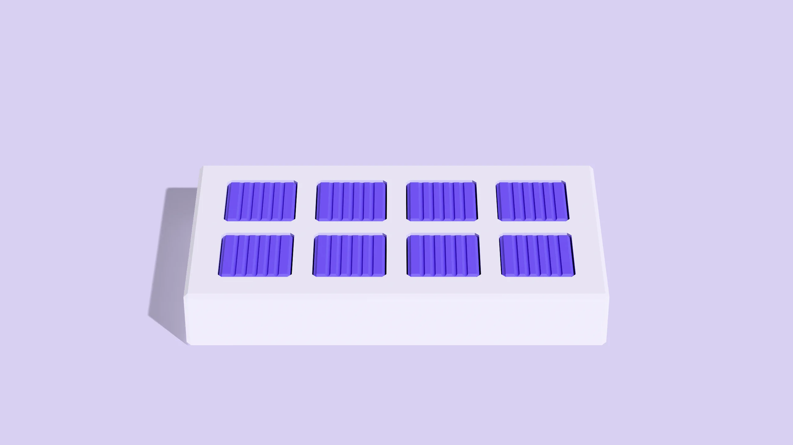
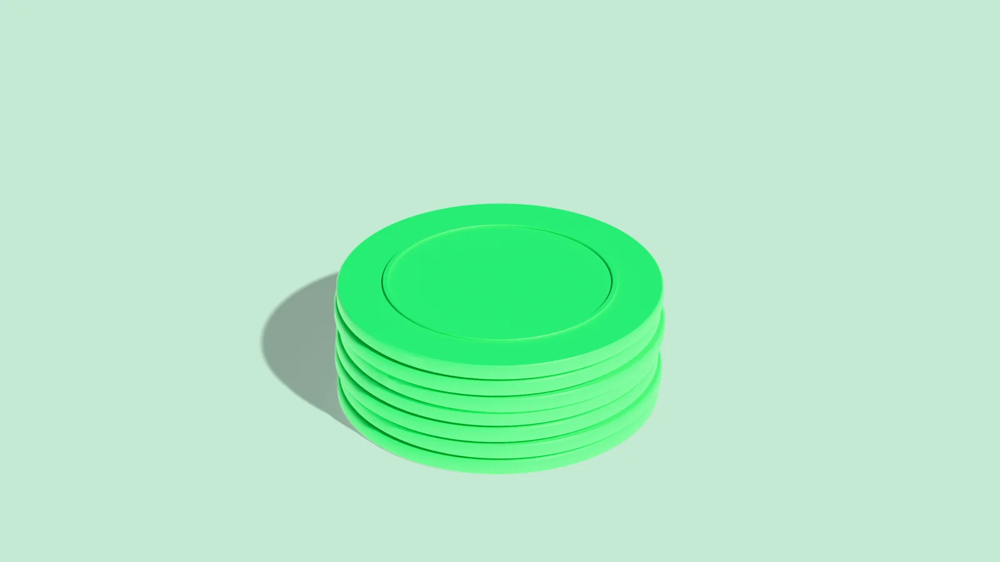

# Mockup kit — plan 002

Shared components for the plan 002 mockups (the sub pages and the app, brought onto the new landing style).
`kit.css` sits on top of the real `landing-site/styles.css` + `pages.css`. It reuses the landing's own classes
wherever they exist and adds only what the sub pages need; every class it adds starts with `kit-`.

- **Reference pages:** `how-it-works.html` (the full template, top to bottom) and `kit.html` (a sheet of every
  component How It Works doesn't use). Screenshots of both are in `shots/`.
- **Copy from them, don't retype.** The nav, sprite, closer and footer are long; take them from `how-it-works.html`.

## 0. Page skeleton

```html
<!doctype html>
<html lang="en">
<head>
<meta charset="utf-8">
<meta name="viewport" content="width=device-width, initial-scale=1">
<title>Pricing — mockup 002</title>
<link rel="icon" type="image/svg+xml" href="../../../landing-site/assets/favicon.svg">
<link rel="preconnect" href="https://fonts.googleapis.com">
<link rel="preconnect" href="https://fonts.gstatic.com" crossorigin>
<link href="https://fonts.googleapis.com/css2?family=Geist:wght@400..700&family=Geist+Mono:wght@400;500&family=JetBrains+Mono:wght@400;500&family=Schibsted+Grotesk:ital,wght@0,400..800;1,400..800&display=block" rel="stylesheet">
<link rel="stylesheet" href="../../../landing-site/styles.css">
<link rel="stylesheet" href="../../../landing-site/pages.css">
<link rel="stylesheet" href="kit.css">
<style>/* page-specific bits only */</style>
</head>
<body class="kit">
  <!-- 1. the SVG sprite: copy the <svg width="0" height="0" …>…</svg> block from how-it-works.html
          (it is landing-site/src/partials/sprite.html). The app mock and arrows use it. -->
  <div class="kit-mock-label">Mockup · 002 · Pricing</div>
  <!-- 2. the nav: copy <header class="the-nav" theme="grey">…</header> from how-it-works.html, then move
          `current` to your page's <li class="group">. Links already point at the sibling mockups
          (how-it-works.html, what-it-checks.html, pricing.html, research.html, guides.html, security.html, about.html). -->
  <main class="page">
    <!-- hero (§2) → ink section (§3) → paper section (§4) holding steps/blocks → closer → footer -->
    <!-- 3. closer + footer: copy everything from <section class="section closing"…> to the end of </main>
            from how-it-works.html (it is partials/closing.html + partials/footer.html with paths fixed). -->
  </main>
</body>
</html>
```

Rules that hold everywhere:
- **Type:** Schibsted display, semibold, sentence case, never capitals; at most one `<em>` per heading (most headings
  have none). Geist for reading. Geist Mono only for small capped labels and step numbers.
- **Colour:** grey hero (`theme="grey"`) → ink rounded section (`theme="black"`) → paper (`theme="white"`).
  Neon green `#00fd74` only for: money that comes back, one CTA per section, status dots. Never icon tiles, bars,
  tag fills or backgrounds. Pastels only inside exhibit tiles and chips.
- **Assets** (relative paths from this folder): `../../../landing-site/media/hero/first.webp` (+ `d.mp4`),
  `…/media/exhibits/{echo,overflow,piece,shadow}/still.webp` and `still-m.webp`, `…/media/macbook/still.webp`,
  `…/media/closing/coins-720.webp` / `coins-1200.webp`. Nothing else: no `/media/connect|find|build|recover.*`,
  `hero.webm/.mp4`, `hero-white.mp4`, `/assets/dept-*`, `/assets/cs-*`, `public/onboarding`, `public/generated`,
  `src/assets/landing`.
- **Copy:** from the current page source (`landing-site/src/pages/<page>.html`). Trim and reorder; never invent
  claims or numbers.
- **Sizes in rem** (rem scales with the viewport, as on the landing). Mobile layout switches at 1023px.
- No `loading="lazy"` on images (a static full-page screenshot never scrolls them in).

## 1. Eyebrow — `.kit-eyebrow`
Mono, small capitals, grey (half-white on ink). Step number first when the section is a step.
```html
<p class="kit-eyebrow">01 · Connect</p>
<h2 class="heading type-h3">Start with what you have.</h2>
```

## 2. Page hero — `.hero-home.kit-hero` (+ `.is-tile`)
The landing's hero with a sub page's measure: optional eyebrow, ink h1 with one `<em>`, description, CTA pair
(ink + text link), 3D slot on the right. Default slot = the record-stack film on the hero's own floor.
```html
<section class="hero-home kit-hero" theme="grey">
  <div class="bg">
    <div class="bg-wrap the-grid"><div class="wrap"><video class="hero-film" autoplay loop muted playsinline preload="auto" poster="../../../landing-site/media/hero/first.webp" aria-hidden="true"><source src="../../../landing-site/media/hero/d.mp4" type="video/mp4"></video></div></div>
  </div>
  <div class="content the-grid">
    <p class="kit-eyebrow kit-hero-eyebrow">How it works</p>
    <h1 class="heading heading1 type-h1">Records in.<br>Recoveries <em>out.</em></h1>
    <div class="desc">
      <p class="type-body-large">Add an export from your accounting system. …</p>
      <div class="hero-ctas">
        <a href="#" class="cta cta-button" size="large" theme="black"><span class="hover-loop"><span class="inner">Run a free audit</span></span></a>
        <a href="what-it-checks.html" class="cta cta-button has-arrow" size="large" theme="none"><span class="hover-loop"><span class="inner">What it checks<svg class="icon"><use href="#i-arrow"/></svg></span></span></a>
      </div>
    </div>
  </div>
</section>
```
Tile variant (an exhibit still or placeholder in the slot instead of the film) — add `is-tile` and put a tile in `.wrap`:
```html
<section class="hero-home kit-hero is-tile" theme="grey">
  <div class="bg"><div class="bg-wrap the-grid"><div class="wrap">
    <div class="fd-tile kit-ph" data-hue="blue"><span class="kit-ph-tag">Piece to render · sealed record box</span><!-- svg.kit-ph-obj (§6) --></div>
    <!-- or a still: <div class="fd-tile" data-ex="piece"></div> -->
  </div></div></div>
  <div class="content the-grid"> …eyebrow, h1, desc as above… </div>
</section>
```

## 3. Ink rounded section with numbered columns — `.rounded-section.kit-ink` + `.content-columns`
The landing's 01/02/03 columns on ink, opening over the grey hero. Replaces the old hero anchor list and the sticky
side index. Three columns by default; `.kit-cols-4` for four. Columns may be links to their sections
(`a.content-column` + the `.kit-col-arrow` down arrow). Optional header (eyebrow + `type-h2`).
```html
<div class="rounded-section kit-ink" theme="black">
  <div class="bg bg-top" theme="grey"></div>
  <div class="bg bg-bottom" theme="black"></div>
  <div class="rs-scale" theme="black">
    <section class="section content-columns" theme="black">
      <div class="the-grid">
        <!-- optional --><div class="header" theme="black" style="grid-column-end:span 8"><p class="kit-eyebrow">What Reclaim reads</p><h2 class="heading type-h2">Read, <em>never</em> write.</h2></div>
        <div class="columns kit-cols-4">
          <a href="#upload" class="content-column"><span class="step-no type-mono">01</span><svg class="kit-col-arrow" aria-hidden="true"><use href="#i-arrow"/></svg><h3 class="heading type-h4">Connect.</h3><p class="desc type-body-medium">Export your bills, payments, vendors and credits …</p></a>
          <!-- 02, 03, 04 … (plain <div class="content-column"> when not a link, no arrow) -->
        </div>
      </div>
    </section>
  </div>
</div>
```

## 4. Paper rounded section — `.rounded-section.kit-paper`
Rises over the ink with the rounded corners. Everything after the ink lives in its `.rs-scale`.
```html
<div class="rounded-section kit-paper" theme="white">
  <div class="bg bg-top" theme="black"></div>
  <div class="bg bg-bottom" theme="white"></div>
  <div class="rs-scale" theme="white">
    <!-- .kit-step / .kit-block / .kit-faq sections -->
  </div>
</div>
```
(If a page has no ink section, put the paper sections straight after the hero as plain `<section class="section …" theme="white">`
and give the first one `bg-top` grey instead.)

## 5. Step — `.kit-step` (`.is-flip`, `.is-split`) and `.kit-step-wide`
Eyebrow + sentence heading + lead + body + a figure. Layouts:
- `.kit-step` — copy left (5 cols), figure right (6 cols)
- `.kit-step.is-flip` — figure left, copy right (alternate with the one above)
- `.kit-step.is-split` — eyebrow + heading left, lead + body right (`.kit-step-text`); the figure goes full width under
- `.kit-step-wide` — any full-width block under the row (app mock, tile row, track). Stack several.
```html
<section class="section kit-step" theme="white" id="upload">
  <div class="the-grid kit-step-row">
    <div class="kit-step-copy">
      <p class="kit-eyebrow">01 · Connect</p>
      <h2 class="heading type-h3">Start with what you have.</h2>
      <p class="kit-step-lead">The records that show a payment mistake already exist: …</p>
      <p class="kit-step-body">Export them the way you normally would, …</p>
    </div>
    <div class="kit-step-fig"><!-- exhibit tile, .kit-brands, .ex-sum … --></div>
    <div class="kit-step-wide"><!-- optional: .kit-app, .kit-tiles, .pipeline.kit-track --></div>
  </div>
</section>

<section class="section kit-step is-split" theme="white" id="find">
  <div class="the-grid kit-step-row">
    <div class="kit-step-copy"><p class="kit-eyebrow">02 · Find</p><h2 class="heading type-h3">Only what the records show.</h2></div>
    <div class="kit-step-text"><p class="kit-step-lead">…</p><p class="kit-step-body">…</p></div>
    <div class="kit-step-wide">…</div>
  </div>
</section>
```
A paper block that isn't a step (stats, a tile row, a list): `.kit-block` with `.kit-block-head` (eyebrow, optional
`h2.heading.type-h3`, optional `p.kit-block-desc`) and `.kit-block-body`:
```html
<section class="section kit-block" theme="white">
  <div class="the-grid">
    <div class="kit-block-head"><p class="kit-eyebrow">AP benchmarks · Ardent Partners</p><h2 class="heading type-h3">…</h2><p class="kit-block-desc">…</p></div>
    <div class="kit-block-body">…</div>
  </div>
</section>
```

## 6. Exhibit tile and exhibit placeholder — `.fd-tile`, `.fd-tile.kit-ph`, rows `.kit-tiles`
**The 3D rule.** The direction is the landing's four section pieces: one smooth, untextured object per tile, one
saturated hue on a pastel of the same hue, a long soft shadow, plain off-white second material. The hues have
meanings — keep them:

| hue | `data-ex` still | `data-hue` (placeholder) | meaning |
|---|---|---|---|
| green | `echo` (coin stack) | `green` | duplicate payment · also payment mismatch (5th check) |
| orange | `overflow` (beads over a bowl) | `orange` | overpayment |
| violet | `piece` (keys in a tray) | `violet` | unused credit · also "your payments"/records cards |
| blue | `shadow` (cube + stepped shadow) | `blue` | duplicate bill · also security |

Tile (a still; the landing's own class, as is — `<a>` when it links somewhere):
```html
<div class="fd-tile" data-ex="echo"><span class="fd-cap"><span class="fd-title">One payment. Made twice.</span><span class="fd-meta">Duplicate payment · $4,280</span></span></div>
```
Placeholder (a piece that doesn't exist yet): the tile in the hue's pastel, a flat silhouette, a dashed inset, and the
tag. The silhouette paints with classes: `hue` / `hue-lt` / `hue-dk` (the object), `sec` / `sec-md` / `sec-sh`
(off-white material), `sec-dk` (a hole in it), `shd` (the long soft shadow, blurred by CSS).
```html
<div class="fd-tile kit-ph" data-hue="green">
  <span class="kit-ph-tag">Piece to render · payment mismatch</span>
  <svg class="kit-ph-obj" viewBox="0 0 400 300" preserveAspectRatio="xMidYMid slice" aria-hidden="true">…</svg>
  <span class="fd-cap"><span class="fd-title">Billed one amount. Paid another.</span><span class="fd-meta">Payment mismatch</span></span>
</div>
```
Keep the object inside x 100–300, y 60–250 of the 400×300 box so every crop (16:9, 4:3, 5:4) holds it. Three ready
silhouettes (paste inside the `<svg>`):

Disc too big for its socket — **payment mismatch** (green):
```html
<ellipse class="shd" cx="128" cy="206" rx="96" ry="24" transform="rotate(-8 128 206)"/>
<path class="sec-sh" d="M102 190v26a78 26 0 0 0 156 0v-26z"/>
<ellipse class="sec" cx="180" cy="190" rx="78" ry="26"/>
<ellipse class="sec-dk" cx="180" cy="191" rx="42" ry="13"/>
<ellipse class="shd" cx="196" cy="176" rx="50" ry="11" style="opacity:.55"/>
<path class="hue-dk" d="M194 116v18a58 19 0 0 0 116 0v-18z"/>
<ellipse class="hue" cx="252" cy="116" rx="58" ry="19"/>
<ellipse class="hue-lt" cx="252" cy="115" rx="45" ry="14"/>
<ellipse class="hue" cx="252" cy="116.5" rx="41.5" ry="12.6"/>
```
Sealed record box — **security** (blue):
```html
<polygon class="shd" points="132,194 200,228 104,250 36,214"/>
<polygon class="hue-dk" points="132,128 200,162 200,228 132,194"/>
<polygon class="hue" points="200,162 268,128 268,194 200,228"/>
<polygon class="sec-sh" points="124,114 200,152 200,168 124,130"/>
<polygon class="sec-md" points="200,152 276,114 276,130 200,168"/>
<polygon class="sec" points="200,76 276,114 200,152 124,114"/>
<ellipse class="sec" cx="234" cy="180" rx="14" ry="17" transform="rotate(-27 234 180)"/>
<ellipse class="hue-lt" cx="234" cy="180" rx="8" ry="10" transform="rotate(-27 234 180)"/>
```
Small stack of records — **your payments / a ledger / research** (violet, or any hue):
```html
<polygon class="shd" points="120,186 200,226 110,246 30,206"/>
<polygon class="sec-sh" points="120,170 200,210 200,226 120,186"/><polygon class="sec-md" points="200,210 280,170 280,186 200,226"/><polygon class="sec" points="200,130 280,170 200,210 120,170"/>
<polygon class="hue-dk" points="120,150 200,190 200,206 120,166"/><polygon class="hue" points="200,190 280,150 280,166 200,206"/><polygon class="hue" points="200,110 280,150 200,190 120,150"/>
<polygon class="sec-sh" points="120,130 200,170 200,186 120,146"/><polygon class="sec-md" points="200,170 280,130 280,146 200,186"/><polygon class="sec" points="200,90 280,130 200,170 120,130"/>
<polygon class="hue-lt" points="168,112 222,139 214,143 160,116"/><polygon class="hue-lt" points="184,104 238,131 230,135 176,108"/>
```
Rows: `.kit-tiles` (2-up, 16:9), `.kit-tiles.is-3` and `.kit-tiles.is-5` (4:3 crops; on phones 2-up, an odd last tile spans the row).
```html
<ol class="kit-tiles is-5">
  <li><a href="what-it-checks.html#duplicate-payments" class="fd-tile" data-ex="echo"><span class="fd-cap"><span class="fd-title">Paid once. Then paid again.</span><span class="fd-meta">Duplicate payment</span></span></a></li>
  <!-- … shadow, overflow, piece, then the green payment-mismatch placeholder -->
</ol>
```

## 7. App mock, flat on paper — `.kit-app` (+ `.is-short`)
The landing's `.app` (dashboard mock-up from `styles.css`) with no tablet bezel: a screen with a hairline, rounded
corners and a soft shadow, cropped like a window. The app lays out at its own rem sizes, zoomed by `--z` to fill the
frame (1.16 desktop; 0.5 on phones, where the sidebar drops). `.is-short` = a wider, shorter crop. Take the `.app`
markup from the BUILT page `landing-site/how-it-works/index.html` (partials expanded) or from `how-it-works.html`
here; drop `data-base-width` and the `.framed` / `.screen-fit` wrappers.
```html
<div class="kit-step-wide">
  <div class="kit-app" aria-hidden="true">
    <div class="app"> <aside class="app-side">…</aside> <div class="app-main">…</div> </div>
  </div>
</div>
```
Change `--z` / `--ratio` inline for a different crop: `<div class="kit-app" style="--z:1.3; --ratio:16/8">`.

## 8. White summary card — `.ex-sum` (landing class, as is) + `.kit-sum-plain`, `.ex-sum-ico.is-line`
Rows with a round render icon (`data-ex`), a kind + sub line, amount, a pastel state chip; a total. For rows that
aren't one of the four mistakes: `data-hue="green|orange|violet|blue|grey"` colours the chip, `.ex-sum-ico.is-line`
holds a stroke icon, and `.kit-sum-plain` drops the amount column.
```html
<div class="ex-sum">
  <div class="ex-sum-head"><h3>Recovery summary</h3><span class="ex-sum-all"><i></i>4 of 4 recovered</span></div>
  <ol class="ex-sum-rows">
    <li class="ex-sum-row" data-ex="echo"><span class="ex-sum-ico" aria-hidden="true"></span><span class="ex-sum-what"><span class="ex-sum-kind">Duplicate payment</span><span class="ex-sum-sub">Example Supply Co. · INV-1834 paid twice</span></span><span class="ex-sum-amt">$4,280</span><span class="ex-sum-state">Refunded</span></li>
  </ol>
  <p class="ex-sum-total"><span>Total recovered<small>Q2 · matched in your books</small></span><strong>$8,970</strong></p>
</div>

<div class="ex-sum kit-sum-plain">
  <div class="ex-sum-head"><h3>What Reclaim reads</h3></div>
  <ol class="ex-sum-rows">
    <li class="ex-sum-row" data-hue="grey"><span class="ex-sum-ico is-line" aria-hidden="true"><svg viewBox="0 0 24 24"><circle cx="12" cy="12" r="3"/><path d="M2.5 12S6 5.5 12 5.5 21.5 12 21.5 12 18 18.5 12 18.5 2.5 12 2.5 12z"/></svg></span><span class="ex-sum-what"><span class="ex-sum-kind">Read, never write</span><span class="ex-sum-sub">Nothing in your books changes.</span></span><span class="ex-sum-state">Read only</span></li>
    <!-- no chip: end the row with an empty <span></span> -->
  </ol>
</div>
```
Pastel chip anywhere — `.kit-chip[data-hue]`; `<i>` adds the green status dot (money back only):
```html
<span class="kit-chip" data-hue="violet">Unused credit</span>  <span class="kit-chip" data-hue="green"><i></i>Recovered</span>  <span class="kit-chip">Not reviewed</span>
```

## 9. Ruled list — `.kit-ruled`
Replaces the black carousel cards (What It Checks examples, About beliefs, Security points). Hairlines, mono index,
Schibsted title, grey body, optional mono meta at right. Works on ink too.
```html
<ol class="kit-ruled">
  <li><span class="kit-ruled-no">01</span><div><h3 class="kit-ruled-title">Was invoice #4471 from the packaging supplier paid twice?</h3><p class="kit-ruled-desc">Yes. $2,640 by ACH on Mar 3, then by check on Mar 11.</p></div><span class="kit-ruled-meta">Check + ACH · Example</span></li>
</ol>
```

## 10. Big-figure stat — `.kit-stats` (`.is-2`) > `.kit-stat`
Mono label, Schibsted figure (unit in `<small>`), one line, the source as a mono link. Replaces stat cards with renders.
```html
<ul class="kit-stats">
  <li class="kit-stat"><span class="kit-stat-label">Days</span><strong class="kit-stat-fig">8.2<small>days</small></strong><p class="kit-stat-desc">The average time it takes to process a single invoice.</p><a class="kit-stat-src" href="…">Ardent Partners</a></li>
</ul>
```

## 11. Ruled FAQ — `.kit-faq`
`partials/faq.html` restyled: heading left, ruled questions right, a thin plus that turns to a cross. Open the first.
```html
<section class="section kit-faq" theme="white" id="faq">
  <div class="the-grid">
    <div class="kit-faq-head"><p class="kit-eyebrow">FAQ</p><h2 class="heading type-h3">Questions, answered.</h2><p class="kit-faq-note">Not sure where to start? <a href="#">Talk to us</a></p></div>
    <ul class="kit-faq-list">
      <li><details open><summary>What records does Reclaim need?</summary><p>Your bills, the payments against them, …</p></details></li>
    </ul>
  </div>
</section>
```

## 12. Flagged → Settled track on paper — `.pipeline.kit-track`
The landing's "most tools stop here" diagram (`.pl-*`, unchanged markup), recoloured for paper: the Reclaim lane in
ink, green only on the last node. Vertical on phones. Copy the block from `landing-site/src/pages/index.html`
(`<div class="pipeline" data-pipeline>`), drop `data-pipeline`, add `kit-track`:
```html
<div class="pipeline kit-track">
  <div class="pl-lane is-others" aria-hidden="true"><span class="pl-who type-mono">Most tools</span><i class="pl-track"></i><i class="pl-fill"></i><i class="pl-node is-start"></i><i class="pl-stop"><span class="type-mono">Stops here</span></i></div>
  <div class="pl-lane is-us" aria-hidden="true"><span class="pl-who type-mono">Reclaim</span><i class="pl-track"></i><i class="pl-fill"></i><i class="pl-node"></i><i class="pl-node"></i><i class="pl-node"></i><i class="pl-node"></i><i class="pl-node is-end"></i></div>
  <ol class="pl-steps">
    <li><span class="pl-no type-mono">01</span><strong>Flagged</strong><p>A possible duplicate, with the amount at stake.</p><span class="pl-note type-mono">Most tools stop here</span></li>
    <!-- 02 Proven · 03 Approved · 04 Requested · 05 Settled -->
  </ol>
</div>
```
(Exactly five steps: the lanes are drawn for five columns.)

## 13. Trust strip — `.closing-promises.kit-trust`
The closer's three promises (line icon in a grey square, title, one line), usable anywhere.
```html
<ul class="closing-promises kit-trust">
  <li><span class="closing-ico" aria-hidden="true"><svg viewBox="0 0 24 24"><rect x="5" y="10.5" width="14" height="10" rx="2"/><path d="M8.5 10.5V8a3.5 3.5 0 0 1 7 0v2.5"/></svg></span><h3>Never changes your books</h3><p>Reclaim works from the records you give it. …</p></li>
</ul>
```

## 14. Export tiles — `.kit-brands` > `.grid-item-brand`
The landing's system tiles, two to a row inside a figure. `idx="0"` = ink tile with the green dot; others paper.
```html
<ul class="kit-brands">
  <li><div class="grid-item-brand" idx="0"><div class="m3d"><div class="rotate"><div class="wrap"><span class="wm wm-quickbooks">quickbooks</span><span class="depth type-mono">CSV export</span></div></div></div></div></li>
  <li><a href="guides.html" class="grid-item-brand" idx="1"><div class="m3d"><div class="rotate"><div class="wrap"><span class="wm wm-netsuite">NETSUITE</span><span class="depth type-mono">CSV export</span></div></div></div></a></li>
</ul>
<p class="kit-brands-note">Step-by-step export guides for the common systems → <a href="guides.html">Guides</a></p>
```
Wordmark classes: `wm-quickbooks`, `wm-xero`, `wm-netsuite`, `wm-bill`, `wm-ramp`, `wm-csv`.

## 15. Corner label — `.kit-mock-label`
`<div class="kit-mock-label">Mockup · 002 · Page name</div>` right after the sprite. Fixed, top right under the nav.

## Serving and screenshots (what tripped us up)
- Serve the repo root (`npx http-server /home/user/AP-Leak-Finder -p <port> -c-1 -s`) and open
  `http://localhost:<port>/docs/mockups/002-subpages-and-app/<file>.html`.
- In Playwright use `waitUntil: 'load'`, not `networkidle` (the hero video keeps the network busy and it never settles).
- Before a full-page screenshot, scroll the page top to bottom once and back: Chromium doesn't paint images it hasn't
  decoded near the viewport, so tiles further down come out as empty floors otherwise.
- This Chromium can't play the H.264 film; the poster (`first.webp`) is what the shots show.
