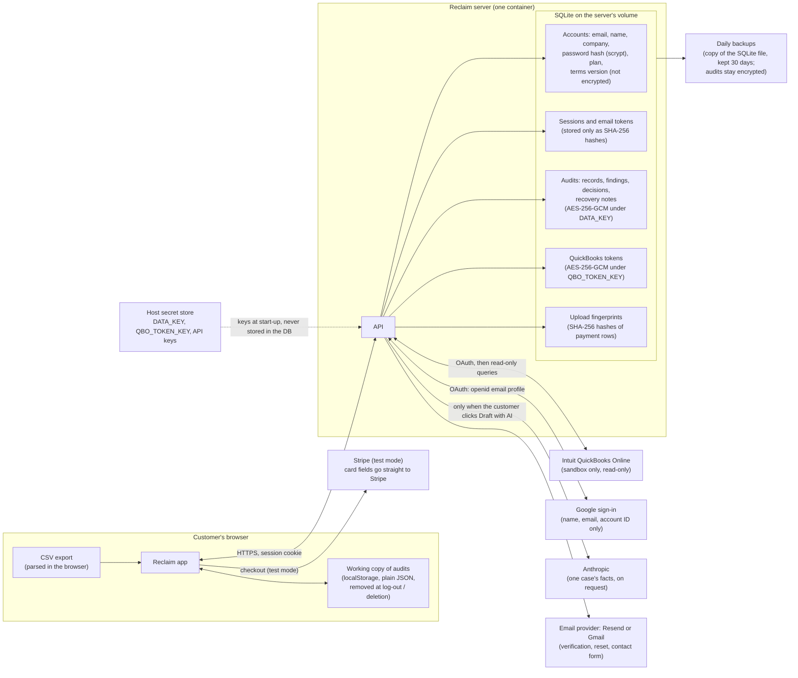

# Reclaim pilot data policy (draft for founder review)

**Status:** draft, written 2026-10-17 from what the code does on `main` plus the
data-safety branch (REC-20). Nothing here is a public commitment until Jagan and
Sid approve it and the Privacy Policy is updated to match (see the end).
Items marked **Decision** are for the founders.

## In one paragraph

During the supervised pilot, Reclaim holds only what a business uploads or
imports to look for duplicate supplier payments, plus the account details
needed to sign in. Each saved audit is encrypted on the server with a key kept
outside the database. Reclaim reads from QuickBooks but never writes to it,
never moves money and never contacts a supplier. It sends data to an outside
service only when the customer starts that step: signing in with Google,
connecting QuickBooks, or asking for an AI-drafted letter. Customers can
download everything or delete their account themselves, from Settings.

## How data moves

## What Reclaim holds, and how

| Data | Where | Protection | Kept until |
|---|---|---|---|
| Account: email, first and last name, company, plan, when and which Terms version was accepted | Server database | Not encrypted in the database. HTTPS in transit. Visible only to the account. | The customer deletes the account, or asks us to. |
| Password | Server database | Only a scrypt hash with a per-account salt. The password itself is never stored or logged. | Account deletion. |
| Sessions, email-verification and reset links | Server database | Only SHA-256 hashes of the tokens. The session cookie is HttpOnly and Secure. | Expiry (1 day, or 30 with "keep me logged in"), log-out or deletion. |
| Audits: payment records from the upload or QuickBooks import, findings, decisions, evidence, recovery notes and letters, and the audit's name and file name | Server database | Encrypted with AES-256-GCM under `DATA_KEY`, tied to the account and audit, so a copied row can't be opened under another account. | The customer deletes the audit or the account. |
| Upload fingerprints (used to stop the same file being re-run on Free) | Server database | SHA-256 hashes of vendor, invoice, date and amount, never the values themselves. | Account deletion. |
| QuickBooks connection: company name, realm ID, access and refresh tokens | Server database | Tokens encrypted with AES-256-GCM under `QBO_TOKEN_KEY`. Never sent to the browser or written to logs. | The customer disconnects, or deletes the account. Either way Reclaim asks Intuit to revoke access first. |
| Working copy of audits | The customer's browser (localStorage) | Plain JSON on the customer's device, kept separately for each account. | Log-out or account deletion clears it. |
| Backups | Off the server (location: **Decision**) | Audits inside stay encrypted under that day's `DATA_KEY`. Account rows are not encrypted, so store backups encrypted at rest. | 30 days (proposed). |
| Keys (`DATA_KEY`, `QBO_TOKEN_KEY`) and provider secrets | Host's secret store | Never in the database, image, repository or logs. | Rotated as in `docs/deploy.md` §6–7. |

Reclaim does not keep the uploaded file as a file. The browser parses it, and
the audit saves the parsed records **and each row's original column values**
(so import results stay explainable), inside the encrypted audit. Whatever
columns the export contained, bank details included, are therefore held in
the audit until it is deleted. **Decision:** whether to tell pilot customers to
remove columns Reclaim doesn't need before exporting.

## What goes to other companies

Each one receives data only when the customer starts that feature.

- **Hosting provider** (not chosen yet, **Decision**): runs the server and stores the database volume and backups.
- **Intuit** (QuickBooks Online, sandbox only during the pilot): learns that the company authorised Reclaim. Reclaim reads bills, bill payments, vendors, vendor credits, deposits and purchases, and never writes anything back.
- **Google** (optional sign-in): Reclaim asks only for `openid email profile`. Google learns the person signed in to Reclaim.
- **Anthropic** (AI drafting, paid plans, only when the server has a key): when the customer clicks Draft with AI, the facts of that one case are sent: vendor, finding, amounts, invoice numbers, dates and terms, any note the customer adds, and the sender's name. Saved reviewer notes, bank details and the rest of the ledger are not part of the request.
- **Resend or Gmail** (email): the recipient's address and the email itself (verification and reset links, contact-form messages).
- **Stripe** (checkout, test mode only): card details typed at checkout go straight to Stripe. No real charges are made during the pilot.
- **Google Fonts**: the marketing pages load fonts, so Google may see the visitor's IP address.

Reclaim does not sell data, use it to train models, or share it between customers.

## What customers can do themselves

- **Export my data** (Settings → Your data): one JSON file with the account details, the QuickBooks connection summary, and every audit decrypted in full. It never includes passwords, tokens or hashes.
- **Delete my account** (Settings → Your data): the customer types their email to confirm. Reclaim first asks Intuit to revoke the QuickBooks connection, then deletes the account and every row tied to it (sessions, links, audits, upload fingerprints, plan usage, connections) in one step. Deleted content is zeroed in the database file, not left behind in free space. Every device is signed out, and the browser's working copy is cleared.
- **Delete one audit** (Settings → This audit's data).
- **Disconnect QuickBooks** at any time. Reclaim asks Intuit to cancel access and deletes the stored tokens.
- **Changed terms:** when the Terms or Privacy Policy change (`TERMS_VERSION`), a signed-in customer must accept the new version before carrying on, or log out. They can read both documents first.

**Limit to state honestly:** a deleted account still exists in backups taken
before the deletion, until those backups expire (30 days proposed). Restoring an
old backup would bring it back. **Decision:** whether to re-delete restored
accounts from a deletion log, or simply state the 30-day backup window.

## Pilot rules for the team

1. Real customer data only on the production server. Never on a laptop, in a test database, a screenshot, a demo or a support chat. Ask a pilot customer for permission before looking inside their audit, and only to help with what they asked about.
2. Keys and secrets live only in the host's secret store. One offline copy of `DATA_KEY` is kept apart from the backups (**Decision:** where, and who holds it).
3. Backups are copied off the server daily, stored encrypted, kept 30 days, and accessible only to the founders.
4. QuickBooks stays sandbox-only until Intuit's app assessment is passed.
5. If data may have been exposed: rotate the affected keys (`docs/deploy.md` §6–7), tell affected customers promptly (**Decision:** the timeframe, e.g. 72 hours), and write down what happened.
6. At the end of the pilot, delete the accounts of customers who don't continue, unless they ask us to keep them (**Decision:** proposed 30 days after the pilot ends, with notice first).

## Known gaps (not yet true, so don't claim them)

- Account details (email, names, company) are encrypted in transit but not at rest in the database. Only audits and QuickBooks tokens are.
- Plaintext from before encryption may remain in old backups or snapshots, and in disk blocks the filesystem freed. Use an encrypted host volume, and delete backups from before encryption (`docs/deploy.md` §6).
- The browser's working copy is not encrypted. It is removed at log-out.
- No third-party security certification (SOC 2, ISO 27001).
- Rate limits share one budget behind the hosting proxy (`docs/deploy.md` §3).
- Automatic Gmail sending, if built, adds Google mail access. This policy will need updating then.

## Privacy Policy changes to make before launch (founder review)

The current Privacy Policy (`src/pages/PrivacyPage.tsx`, version `2026-10-16-draft`) understates what Reclaim now does:

- §8 says uploaded records "are not yet encrypted at rest". Replace with: audits are encrypted at rest with AES-256-GCM under a key kept outside the database. Account details are not.
- §11 should add **Export my data** and **Delete my account** in Settings, and the 30-day backup window.
- §7 still has the placeholder for hosting provider, region, backups and retention. Fill it in once those decisions are made.

Changing the policy means bumping `TERMS_VERSION` in `src/legal/terms.ts`. Every signed-in customer is then asked to accept the new version at their next visit.
